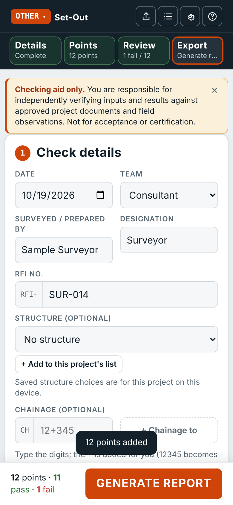
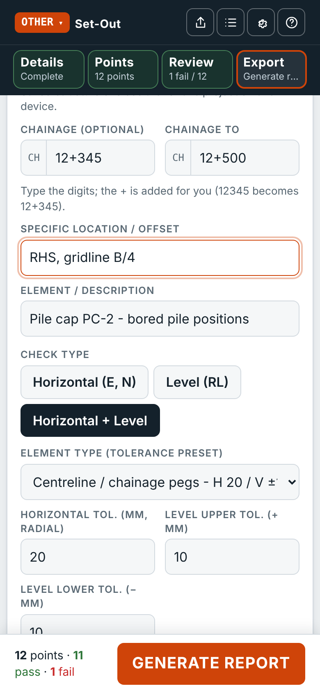
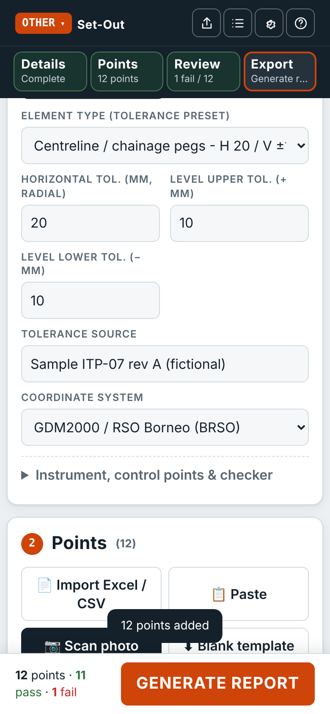
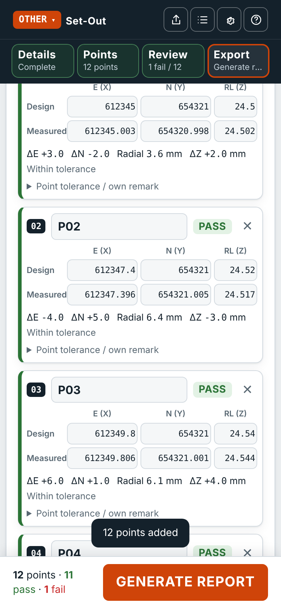
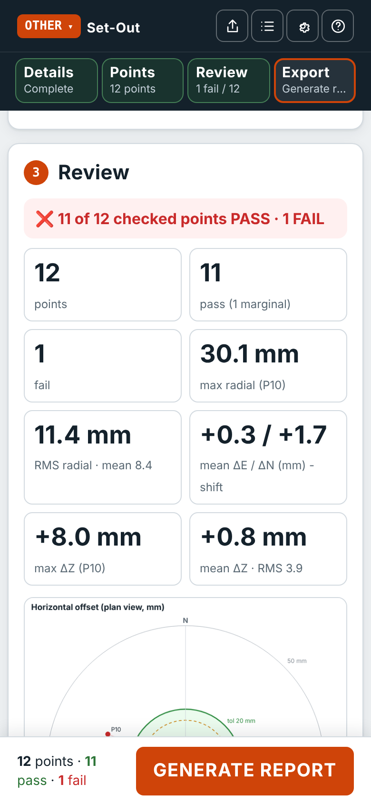
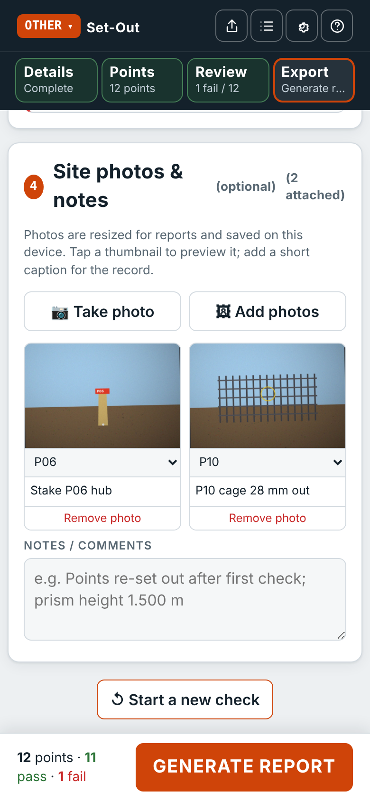
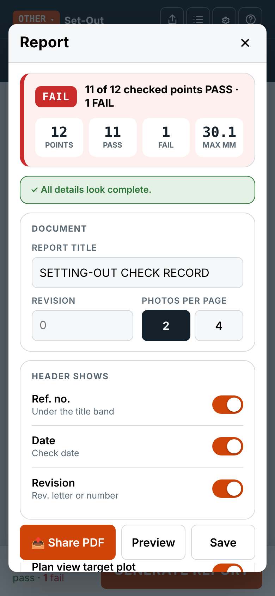
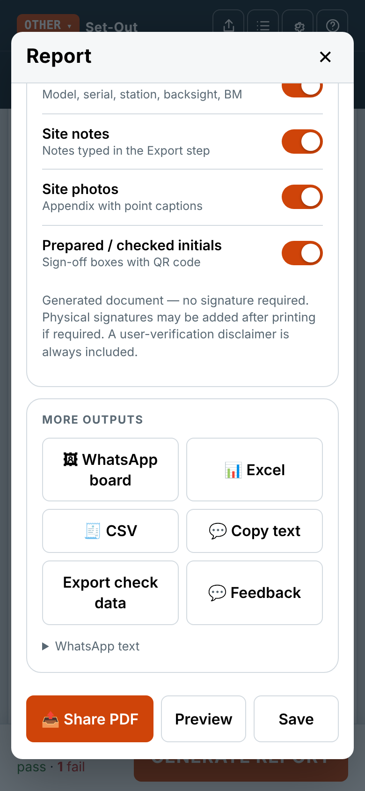
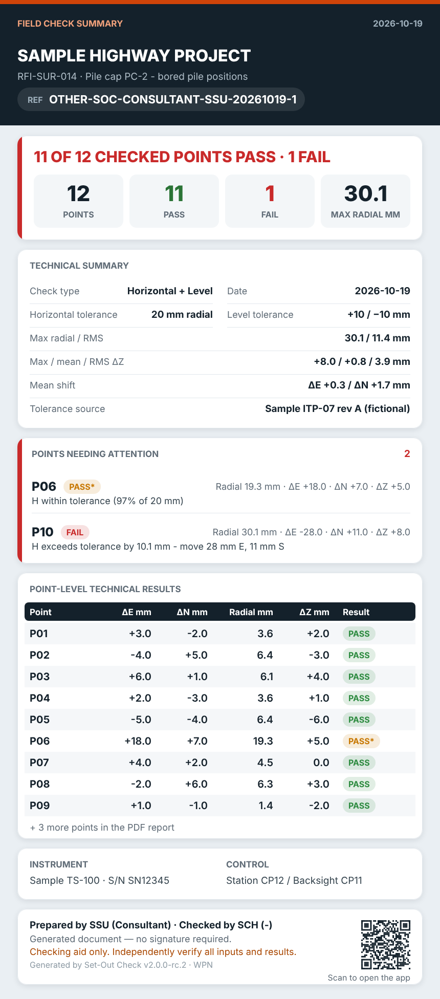
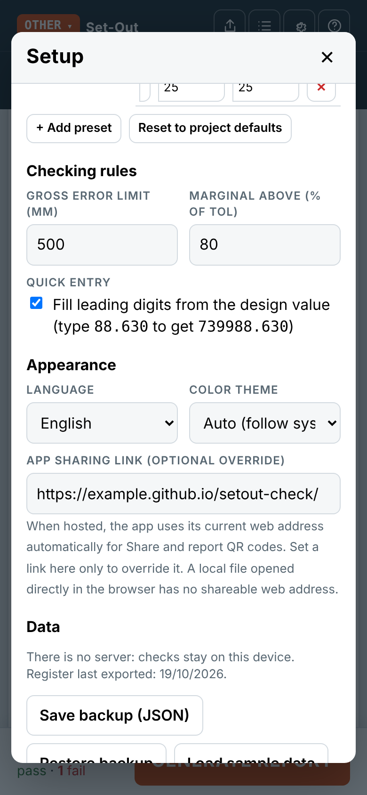

# Set-Out Check: user guide

Developed by WPN.

> **Checking aid only — the user is responsible for verification.** Check point identity, source data, units, coordinate/vertical datums, approved tolerances and results against the approved project documents and field observations. The app does not independently verify, accept or certify survey work. Do not rely on it alone to approve or direct construction.
>
> Screenshots below use fictional training data. Do not use those values or the indicative presets as project tolerances.
>
> For a complete worked example, see [Sample Set-Out Check Results](SAMPLE-RESULTS.md).

## 1. Open the app and pick the project

1. Open the app link on your phone. On iPhone: **Share → Add to Home Screen**. On Android (Chrome): **⋮ → Add to Home screen / Install app**.
2. The project code is at the top left, e.g. **OTHER ▾**. Tap it to choose another project. Each project keeps its own check, so switching does not lose your work.

The bar under the title shows the four steps: **Details → Points → Review → Export**. Tap a step to jump to it; each shows its status (e.g. *12 points*, *1 fail / 12*). The big button at the bottom moves you to the next step.

## 2. Fill in the check details (section 1)

- **Date, team, surveyed by, designation**: your name, team and instrument are remembered for the next check.
- **RFI no.**: type only the number part, e.g. `SUR-123`. The project's prefix is added in front.
- **Structure**: choose from the project's category-grouped list or choose **Other / enter a custom structure**. Manage reusable custom structures in **Setup → Project details & logos**; these stay on this device for the selected project and are included when you export its project file.
- **Chainage** (optional): enter the starting chainage. Tap **+ Chainage to** to add an end value for a range. Type all the chainage digits; the `+` is inserted before the final three digits (e.g. `12345` becomes `12+345`, and `1234567` becomes `1234+567`).
- **Specific location / offset** appears when you tap **+ Specific location / offset**. Use it instead of or alongside chainage for details such as *RHS*, *bridge pier* or *gridline B/4*.
- **Element / description**: say what was set out, e.g. *Pier 2 pile cap - pile positions*.
- **Check type**: *Horizontal (E, N)*, *Level (RL)* or *Horizontal + Level*.
- **Element type**: picks the tolerance. Horizontal tolerance is radial; level has separate upper (+) and lower (−) limits. Change them to match the approved ITP / Method Statement, and write where the tolerance comes from in **Tolerance source**.
- **Instrument, control points & checker** (tap to open): instrument model, serial no., calibration date, station, backsight, BM/TBM, and who checked it — name, team and designation. Generated reports show preparer and checker initials only; no signature is required on the generated document.

## 3. Enter the points (section 2)

Pick whichever is easiest:

| Button | Use it when |
|---|---|
| **📄 Import Excel / CSV** | You have the design coordinates (or both design and measured) in a spreadsheet, e.g. the *Survey Checking Template*. |
| **📋 Paste** | You copied rows from Excel, a text file or a message. |
| **📷 Scan photo** | You have a printed schedule, a field book page or an instrument screen. Choose what is in the photo and whether the values are design or measured. |
| **+ Add point** | Typing by hand. |
| **PDF schedule** | Use *Import Excel / CSV* and choose a PDF whose table is real text (not a scan): the rows go to the review table. |
| **⬇ Blank template** | Download the Excel template to fill in on a laptop. |

After an import, paste or scan, a **review table** opens:

- Check the drop-down above each column says what the column is (Point name, Design E, Measured N …).
- Check the values against the source. Yellow = hard to read; red = not a number. Tap a cell to correct it.
- Untick rows you don't want.
- **Add to the check as**: *Replace all points*, *Add as new points*, or *Merge by point name*. Use **Merge** to import the design values first and the measured values later.

**Coordinate order:** instruments differ (E, N or N, E). The review table has a *Coordinate order* selector. If the check already has design values, the app compares the file with them and picks the right order by itself; otherwise check the message under the selector.

**Quick entry:** in a coordinate box you can type only the last digits, e.g. `88.630`. When you leave the box it becomes `739988.630`, taking the leading digits from the design value. Turn this off in **Setup** if you prefer.

Each point card shows its result straight away:

| Result | Meaning |
|---|---|
| **PASS** | Within tolerance |
| **PASS (marginal)** / **PASS\*** | Within tolerance, but over 80 % of it |
| **FAIL** | Outside tolerance. The remark says by how much and which way to move, e.g. *move 9 mm W, 6 mm S* or *lower 12 mm* |
| **CHECK** | Very large difference (over 500 mm) or E and N look swapped: check the point name and the reading |
| **PENDING** | Design or measured value missing |

Tap **Point tolerance / own remark** on a card to give one point its own tolerance or remark.

## 4. Read the summary (section 3)

- The count of PASS / FAIL, max and RMS radial offset, max ΔZ.
- **Mean ΔE / ΔN (shift)**: if every point is off in the same direction, the instrument set-up (station or backsight) may be wrong rather than the pegs.
- The **target plot** shows each point's offset from design in plan, with the tolerance circle. Its scale expands to include the furthest measured offset; point labels are reduced on dense plots to avoid collisions. The **level chart** shows ΔZ per point.

## 5. Photos and notes (section 4, optional)

Add site photos with captions, and pick the point each one shows and any notes, e.g. *prism height 1.500 m*. Photos are resized and stored on this device; tap a thumbnail to preview it. In the Report dialog, choose whether photos and notes appear in the PDF and select **2 photos per page** or **4 photos per page**. The PDF picks the grid that renders each photo largest — two side by side on a landscape page, or stacked when that is better — and sizes every card to hug its own photo and caption, so mixed photo sizes do not waste space.

## 6. Generate the report

**Re-check:** if points fail, tap **Re-check failed points** in section 3. A new revision starts with only those points (design values kept, measured values cleared). In **Generate report** you can type the revision and choose whether the ref. no., date and revision show in the PDF header.

Tap **Generate report**. The Report screen is laid out top to bottom:

1. **Result summary:** PASS / FAIL, the counts and the largest radial offset. Below it, either *All details look complete* or a list of things to check first (missing names, tolerance, incomplete points).
2. **Document:** the report title, the **revision** and the number of **photos per page** (2 or 4).
3. **Header shows:** switches for the ref. no., date and revision in the PDF header.
4. **Report contents:** switches for the plan plot, level chart and statistics, instrument and control, site notes, site photos and the prepared / checked initials.
5. **More outputs:** WhatsApp board, Excel, CSV, copy WhatsApp text, export check data and feedback.
6. **Share PDF / Preview / Save** stay at the bottom of the screen while you scroll.

Good to know:

- A user-verification disclaimer is always in the PDF and cannot be switched off.
- The prepared / checked details use initials only. No signature is required on a generated document.
- A compact QR code opens the hosted app. It carries only the app link, never the check data.
- **Export check data** downloads a JSON file with the check details, points and photos. The other user imports it through **Setup → Restore backup**.
- **Excel** uses the template layout with live formulas plus a *Details* sheet.
- **WhatsApp board** is a summary image (result, counts, technical summary, points needing attention, point table, instrument and control). Use the switches in its preview to hide parts, edit the caption, then share. If image sharing is unavailable the PNG downloads and the caption can be copied. No point coordinates are included.
- **Feedback** opens WhatsApp with a short message ready; choose the chat yourself.

Choose a color theme and **English** or **Bahasa Malaysia** for the core interface labels and report/share outputs in **Setup**. The checking notice at the top of the page can be dismissed; its full text remains in **Help → About** and in generated reports. When hosted, the app detects its web address for Share and report QR codes; set an **App sharing link** override only if needed. App QR codes share the app link only. To import a check-transfer JSON file, open **Setup → Restore backup** and select the file; the app will ask before replacing that project's current draft.

Every shared or saved report is kept in the **Register** (top right). Open an old check from there to correct it and share it again (same ref. no.).

After you preview, save or share a PDF, use the visible **Start a new check** action in the report dialog to begin the next report. The **Start a new check** button below the form is also available; either clears the points, photos and notes but keeps your team, names, instrument, control and tolerance.

## 7. Setup

- **AI scan (Gemini)**: the first time you tap **Scan photo** without a key, a short note explains the options and offers **Go to Setup**. Paste your own free Gemini API key from [aistudio.google.com/apikey](https://aistudio.google.com/apikey) and tap **Test key**. The key stays on your phone.
- **Tolerance presets**: edit, add or reset.
- **Checking rules**: gross error limit (default 500 mm) and the marginal level (default 80 %).
- **Project details & logos**: see below.
- **Appearance**: choose Auto (follow system), Slate & ember, Ocean teal, Forest green, Plum or Graphite dark. *Auto* switches to the dark theme when your phone is in dark mode.
- **Language**: choose English or Bahasa Malaysia for core interface labels and report/share outputs.
- **App sharing link**: the hosted address is detected automatically. Set an optional HTTP(S) override only if needed.
- **Data**: backup and restore, sample data, clear all. Restore backup also accepts a shared check-transfer JSON file.

When hosted, the app checks for service-worker updates while online and shows an in-app reload prompt after new files take control. Updates are not push notifications and are not checked while the app is closed/offline.

### Setting up a project

1. Switch to the project (tap the code at the top left).
2. **Setup → Project details & logos**, or **project code ▾ → Edit project details & logos**.
3. Enter the project code, title (as it should appear on the report), contract no., RFI prefix and teams.
4. Upload the logos: left (client), right (default, e.g. the contractor), and a right logo for each team if wanted (e.g. the consultant's logo when the team is CST).
5. **Save** keeps it on this phone. **Export project file** saves a `.json` file: send it to the app administrator to upload to `packages/`, or share it so others can use **+ Add project from file**.

## Tips

- Check your control first: a mean shift in the same direction on every point usually points to the set-up.
- Use point names that match the drawing or the setting-out schedule, so that *Merge by point name* works.
- Export the register CSV every week (**Register → Export CSV**) and keep it with the project files.
